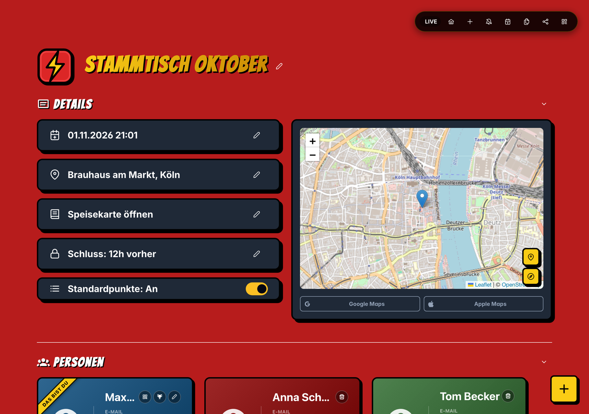
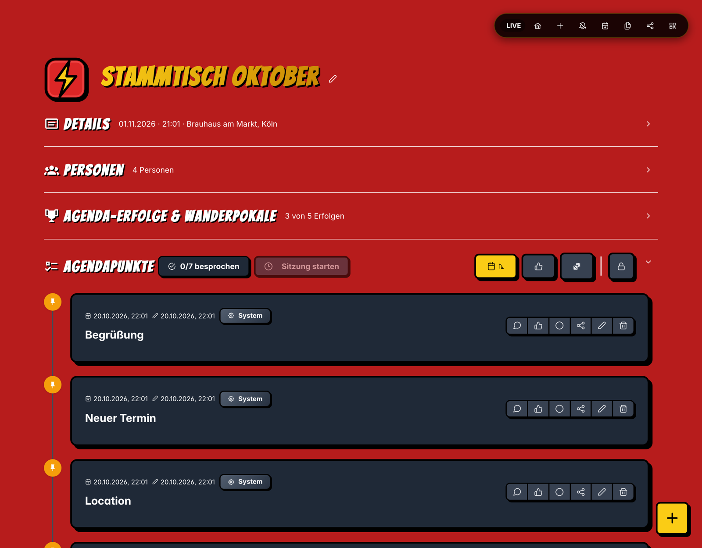
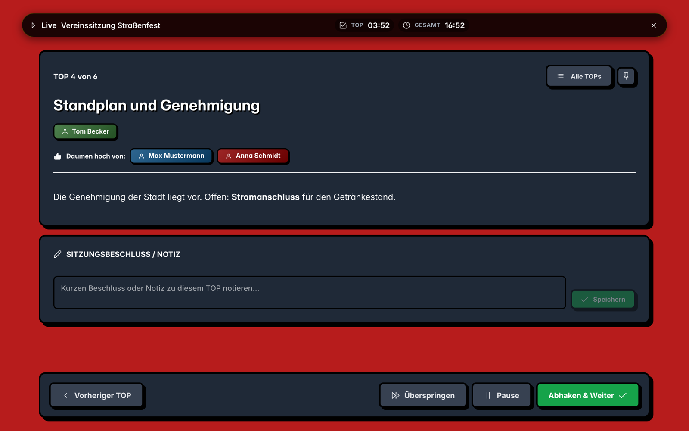
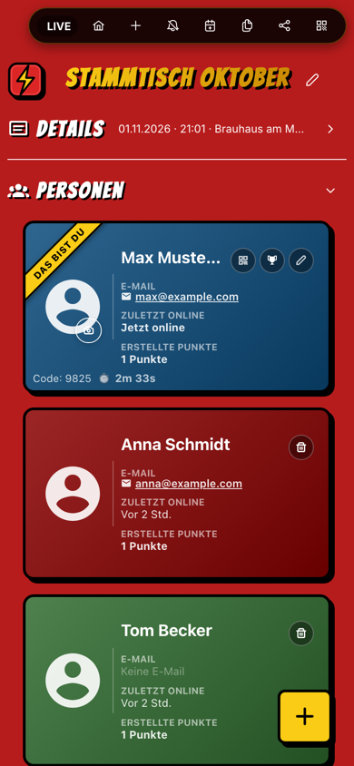

<p align="center">
  
</p>

<p align="center">
  FlashAgenda ist eine moderne Web-Anwendung zur einfachen Erstellung, Verwaltung und interaktiven Anzeige von Agenden, Zeitplänen und Event-Programmen.
</p>

---

## 🚀 Features

- **Agenden in Sekunden**: Agenda anlegen, Link oder QR-Code teilen, alle tragen ihre Punkte selbst ein. Kein Konto nötig, Wiedererkennung per Code.
- **Details auf einen Blick**: Datum, Ort mit Karte (Leaflet / OpenStreetMap), Speisekarte und Annahmeschluss für neue Punkte. Abschnitte lassen sich einklappen und zeigen dann eine kurze Zusammenfassung.
- **Agendapunkte**: Beschreibungen mit Markdown, Bilder, Abstimmungen, Daumen hoch, Kommentare mit Reaktionen und PDF-Anhängen, Anpinnen, Sortieren, Übertragen an andere Personen.
- **Standardpunkte**: Auf Wunsch stehen „Begrüßung“, „Neuer Termin“ und „Location“ automatisch oben.
- **Live-Sitzung**: Präsentationsmodus mit Anwesenheitsabfrage, Timern je Punkt, Beschlüssen, Protokoll-Export (Markdown) und Folge-Agenda mit den gepinnten Punkten. Alle Geräte bleiben synchron.
- **Echtzeit**: Änderungen erscheinen sofort bei allen (Socket.io), inklusive Anzeige, wer online ist.
- **Erfolge**: Persönliche Erfolge und Wanderpokale je Agenda.
- **PWA & Offline**: Installierbar auf dem Handy; Änderungen werden offline zwischengespeichert und später synchronisiert.
- **Kalender & Benachrichtigungen**: Export als `.ics`, Browser-Benachrichtigungen.
- **Admin-Bereich** (`/admin`): Übersicht aller Agenden, geschützt per Passwort.
- **Comic-Look, responsive**: Läuft auf Desktop und Handy.

---

## 📸 Screenshots

### Agenda mit Details, Karte und Personen



### Eingeklappte Abschnitte mit Zusammenfassung und Agendapunkte



### Live-Sitzung (Präsentation)



### Auf dem Handy

<p>
  
</p>

Die Screenshots zeigen die Beispieldaten aus `npm run reset` (siehe „Beispieldaten für die Entwicklung“).

---

## 🛠 Tech Stack

### Frontend
- **Framework**: React 19, TypeScript, Vite
- **UI & Styling**: PrimeReact, PrimeFlex, PrimeIcons, Material Design Icons, Vanilla CSS (Schriften Inter und Bangers)
- **Echtzeit**: Socket.io Client
- **Karten**: Leaflet & React-Leaflet
- **Editor**: MDXEditor
- **PWA**: vite-plugin-pwa
- **Routing & Utilities**: React Router 7, qrcode.react, date-fns, uuid

### Backend
- **Runtime & Framework**: Node.js, Express 5, TypeScript (`tsx`)
- **Datenbank & ODM**: MongoDB, Mongoose
- **Echtzeit**: Socket.io
- **Sicherheit**: Helmet, Rate-Limiting

### Tests
- **Backend**: Vitest & Supertest
- **Frontend**: Playwright (E2E auf Desktop und mobilen Viewports)

### Containerisierung & Scripts
- Docker & Docker Compose
- `start.sh` Bash-Skript für die lokale Entwicklung

---

## 📦 Vorbereitung / Voraussetzungen

- **Node.js** 20.19+ oder 22.12+ (Voraussetzung von Vite)
- **npm** (v10+)
- **Docker** (Docker Desktop oder Colima) für die lokale MongoDB-Instanz oder den Docker-Compose-Build

---

## 🏁 Schnellstart (Lokale Entwicklung)

### Option 1: Per `start.sh` (Empfohlen für Dev)

Das Startskript startet automatisch die MongoDB in Docker sowie Frontend und Backend im Hintergrund:

```bash
chmod +x start.sh
./start.sh
```

- **Frontend**: [http://localhost:5188](http://localhost:5188)
- **Backend API**: [http://localhost:3188](http://localhost:3188)
- **MongoDB**: Ports `27017:27017`

*Beenden aller Dienste mit `Ctrl+C`.*

---

### Option 2: Manuell starten

#### 1. MongoDB starten
```bash
docker run -d -p 27017:27017 --name flashagenda-mongo mongo:latest
```

#### 2. Backend starten
```bash
cd backend
npm install
npm run dev
```

#### 3. Frontend starten (in einem zweiten Terminal)
```bash
cd frontend
npm install
npm run dev
```

---

### Option 3: Mit Docker Compose

Das gesamte Setup (MongoDB, Backend, Frontend) kann in isolierten Containern gestartet werden:

```bash
docker-compose up --build
```

- **Frontend**: [http://localhost:30301](http://localhost:30301)
- **Backend API**: [http://localhost:30302](http://localhost:30302) (im Container Port `3001`; das Frontend leitet `/api` per nginx weiter)
- **MongoDB**: `localhost:30303`, Daten im Volume `mongo-data`

---

### Beispieldaten für die Entwicklung

Sobald MongoDB läuft, aus dem Projektordner:

```bash
npm run reset   # löscht ALLE lokalen Agenden und legt vier Beispiel-Agenden neu an (fragt vorher nach)
npm run links   # zeigt alle lokalen Agenden mit Links, ändert nichts
```

Nach dem Reset stehen die Links zu den Agenden und die Login-Codes der Beispiel-Personen in der Ausgabe (z. B. Max Mustermann: `1111`). Mit `npm run reset -- --yes` entfällt die Rückfrage. Admin-Einstellungen bleiben beim Reset erhalten.

Nur die Beispiele ergänzen, ohne andere Agenden zu löschen: `cd backend && npm run seed`.

Alle drei Befehle laufen ausschließlich gegen eine lokale Datenbank (`localhost`); für andere Ziele ist `SEED_FORCE=1` nötig.

---

## 📁 Projektstruktur

```
FlashAgenda/
├── backend/
│   ├── src/
│   │   ├── models/        # Mongoose-Modelle (Agenda, AdminSetting)
│   │   ├── routes/        # Express-API-Endpunkte (Agenden, Admin)
│   │   ├── services/      # Erfolge, Socket.io, TOTP
│   │   └── server.ts      # Server-Einstiegspunkt
│   ├── scripts/           # Dev-Skripte: Beispieldaten, Reset, Links
│   ├── tests/             # Vitest-/Supertest-Tests
│   ├── .env               # Umgebungsvariablen für das Backend
│   ├── Dockerfile
│   └── package.json
├── frontend/
│   ├── src/
│   │   ├── components/    # UI-Komponenten
│   │   ├── hooks/         # React-Hooks (Socket, PWA, Einklappen)
│   │   ├── pages/         # Seiten (Home, AgendaDetail, AdminPage)
│   │   ├── services/      # Offline-Sync, Erfolge, Benachrichtigungen, TOTP
│   │   ├── utils/         # Hilfsfunktionen
│   │   ├── index.css      # Globale Styles
│   │   └── App.tsx        # Routing & App-Root
│   ├── e2e/               # Playwright-E2E-Tests
│   ├── Dockerfile
│   ├── nginx.conf
│   └── package.json
├── openspec/              # Specs und archivierte Changes (OpenSpec)
├── docs/                  # Dokumentation und Screenshots
├── docker-compose.yml     # Multi-Container-Setup
├── start.sh               # Lokales Dev-Startskript
├── LICENSE
└── README.md
```

---

## ⚙️ Umgebungsvariablen

### Backend (`backend/.env`)

| Variable | Beschreibung | Standardwert |
|---|---|---|
| `PORT` | Port des Backend-Servers | `3188` |
| `MONGO_URI` | Verbindungs-URL zur MongoDB | `mongodb://localhost:27017/flashagenda` |
| `ADMIN_PASSWORD` | Passwort für den Admin-Bereich, solange keins in der Datenbank gesetzt ist | `admin123` |
| `ADMIN_JWT_SECRET` | Schlüssel zum Signieren der Admin-Sitzungen | fester Entwicklungswert |
| `FRONTEND_URL` | Basis-URL für die Links, die die Dev-Skripte ausgeben | `http://localhost:5188` |
| `SEED_FORCE` | `1` erlaubt den Dev-Skripten eine nicht-lokale Datenbank | – |

> ⚠️ Für den Betrieb unbedingt `ADMIN_PASSWORD` und `ADMIN_JWT_SECRET` setzen. Die Standardwerte sind nur für die Entwicklung gedacht.

---

## 📜 Skripte & Befehle

### Projektordner
- `npm test`: Führt Backend- und E2E-Tests aus.
- `npm run reset`: Löscht alle lokalen Agenden und legt die Beispiel-Agenden neu an.
- `npm run links`: Listet alle lokalen Agenden mit Links.
- `npm run build`: Baut das Frontend.
- `npm run release`: Erstellt ein neues Release.

### Backend
- `npm run dev`: Startet den Entwicklungsserver mit Hot-Reloading (`tsx watch` auf Port `3188`).
- `npm run build`: Kompiliert TypeScript nach JavaScript (`dist/`).
- `npm run start`: Startet den gebauten Produktionsserver.
- `npm test`: Führt die Vitest-Tests aus.
- `npm run seed`: Legt Beispiel-Agenden in der lokalen MongoDB an, ohne andere zu löschen.
- `npm run seed:reset`: Löscht alle lokalen Agenden und legt die Beispiele neu an.
- `npm run seed:links`: Listet alle lokalen Agenden mit Links.

### Frontend
- `npm run dev`: Startet den Vite Dev Server (`http://localhost:5188`).
- `npm run build`: Erstellt das Produktions-Bundle (`dist/`).
- `npm run preview`: Zeigt das gebaute Bundle lokal an.
- `npm run lint`: Führt Linter-Überprüfungen durch (`oxlint`).
- `npm run test:e2e`: Führt die Playwright-E2E-Tests aus (startet den Dev-Server selbst).

---

## 📄 Lizenz

FlashAgenda steht unter der [MIT-Lizenz](LICENSE).
